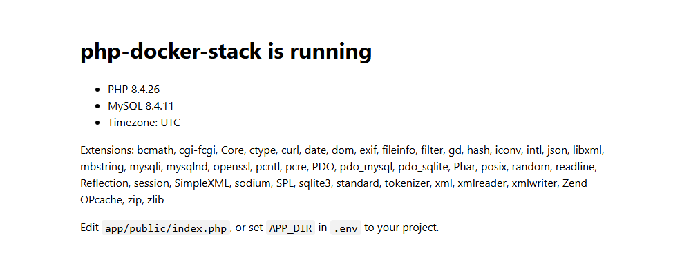

# php-docker-stack

A small, tested **PHP-FPM + Nginx + MySQL** development stack for Docker Compose.
Pick any PHP version from **7.4 to 8.5** with one line in `.env`.

[](https://github.com/iamtanchan/php-docker-stack/actions/workflows/ci.yml)

[日本語はこちら](#日本語)

## Why this one

- **One stack for every PHP version.** Set `PHP_VERSION=7.4` for a legacy app or `8.5` for a new one. CI boots every version on each push and weekly.
- **Safe defaults.** Credentials live in a git-ignored `.env`. MySQL and phpMyAdmin are only reachable from `127.0.0.1`. Nginx refuses to serve dotfiles such as `.env` and `.git`.
- **Runs several projects side by side.** There are no hard-coded container names, and every host port is configurable.
- **No root-owned files.** PHP-FPM and Composer run as a user whose UID/GID match yours.
- **Ready for Laravel.** Includes `pdo_mysql`, `bcmath`, `gd`, `intl`, `zip`, `exif`, `pcntl` and `opcache`, plus Composer 2. Xdebug is one setting away.

## Quick start

Requires Docker with Compose v2.

```sh
git clone https://github.com/iamtanchan/php-docker-stack my-project
cd my-project
cp .env.example .env        # then change the passwords
docker compose up -d --wait
```

Open <http://localhost:8080>. The starter page shows the PHP version, the MySQL connection and the loaded extensions.



## New Laravel project

```sh
# in .env
APP_DIR=laravel
```

```sh
mkdir laravel
docker compose up -d --wait
docker compose exec php composer create-project laravel/laravel .
```

The containers already provide `DB_CONNECTION=mysql`, `DB_HOST`, `DB_DATABASE`, `DB_USERNAME` and `DB_PASSWORD`. Laravel uses them over its own `.env`, so migrations run against MySQL with no extra configuration:

```sh
docker compose exec php php artisan migrate
```

## Existing project

Point `APP_DIR` at the folder that contains your `public/` directory. The path is relative to this repo, for example `APP_DIR=../my-app`. Then run `docker compose up -d`.

## Everyday commands

| Task | Command |
|---|---|
| Shell in the PHP container | `docker compose exec php sh` |
| Composer / Artisan | `docker compose exec php composer install` · `docker compose exec php php artisan ...` |
| MySQL shell | `docker compose exec mysql mysql -u app -p app` |
| phpMyAdmin (<http://localhost:8081>) | `docker compose --profile tools up -d` |
| Switch PHP version | change `PHP_VERSION` in `.env`, then `docker compose up -d --build` |
| Logs | `docker compose logs -f php nginx` |
| Stop / wipe the database | `docker compose down` / `docker compose down -v` |

## Configuration

All settings are in [`.env.example`](.env.example).

| Variable | Default | Notes |
|---|---|---|
| `PHP_VERSION` | `8.4` | Any `php:<version>-fpm-alpine` tag |
| `MYSQL_VERSION` | `8.4` | Any `mysql` image tag |
| `APP_DIR` | `app` | Nginx serves `$APP_DIR/public` |
| `HTTP_BIND` / `HTTP_PORT` | `127.0.0.1` / `8080` | Use `0.0.0.0` to test from a phone on your LAN |
| `MYSQL_PORT` / `PMA_PORT` | `3306` / `8081` | Always bound to `127.0.0.1` |
| `INSTALL_XDEBUG` | `false` | Rebuild after changing. Start a session with the `XDEBUG_TRIGGER` cookie or query parameter, port 9003 |
| `UID` / `GID` | `1000` | On Linux, set these to `id -u` / `id -g` |
| `TZ` | `UTC` | Applied to PHP and MySQL |

To seed the database, drop `.sql`, `.sql.gz` or `.sh` files into `docker/mysql/initdb/`. They run once, when the volume is first created.

PHP settings are in `docker/php/php.ini`. The Nginx site is in `docker/nginx/default.conf`.

## Not for production

These are development defaults: `display_errors` is on and OPcache re-checks files on every request. For production, build a separate image that copies your code in and disables those settings.

## 日本語

PHP-FPM + Nginx + MySQL の Docker Compose 開発環境です。`.env` の `PHP_VERSION` を変えるだけで PHP 7.4〜8.5 を切り替えられます。

```sh
git clone https://github.com/iamtanchan/php-docker-stack my-project
cd my-project
cp .env.example .env        # パスワードを変更してください
docker compose up -d --wait
```

<http://localhost:8080> を開くと、PHP バージョンと MySQL の接続状況が表示されます。

- 認証情報は `.env`（git 管理外）に置きます。MySQL と phpMyAdmin は `127.0.0.1` にのみ公開されます。
- コンテナ名を固定していないので、複数プロジェクトを同時に起動できます。
- Laravel は `APP_DIR=laravel` を設定し、`mkdir laravel`、`docker compose up -d --wait`、`docker compose exec php composer create-project laravel/laravel .` の順に実行します。
- phpMyAdmin は `docker compose --profile tools up -d` で起動します（<http://localhost:8081>）。

## License

[MIT](LICENSE)
